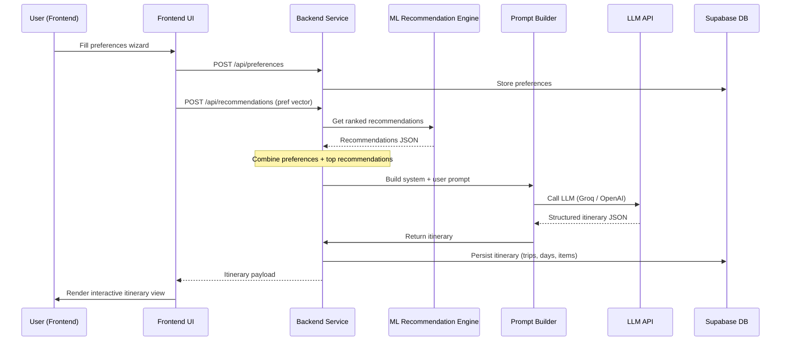

# Architecture Overview

## System Diagram

```mermaid
flowchart LR
    subgraph Frontend[React Frontend (Vite)]
        FE[UI Components]
        State[Zustand / Context]
        Router[React Router]
        API[Axios Calls]
    end
    subgraph Backend[FastAPI Backend]
        BE[FastAPI App]
        Routers[API Routers]
        Services[Business Services]
        ML[ML Models Loader]
        Prompt[Prompt Builder]
        LLM[LLM API Client]
        DB[Supabase Client]
    end
    subgraph Supabase[Supabase]
        Auth[Auth (PostgreSQL)]
        PG[PostgreSQL DB]
    end
    FE -->|HTTP/HTTPS| API --> BE
    BE --> Routers
    Routers --> Services
    Services --> DB
    Services --> ML
    Services --> Prompt
    Prompt --> LLM
    LLM -->|LLM Response| Prompt
    Prompt --> Services
    DB --> Auth
    DB --> PG
```

## Data Flow for Itinerary Generation



---

*The diagrams above capture the high‑level components and the step‑by‑step flow from user input to a generated travel itinerary.*